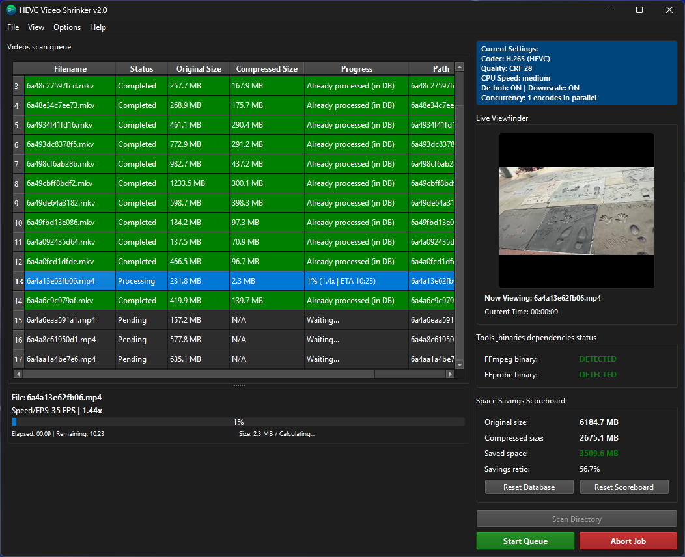

# HEVC Video Shrinker



This is a desktop app version of the older bash script that used to live in this repo. If you've arrived here looking for the script, it's gone, replaced by this app.

This is a cross-platform application that has one - and only one - function: to help you intelligently clean up and shrink large video libraries. If you have a large collection of movies or TV recordings taking up hundreds of gigabytes on your hard drive, this tool will batch-convert your collection into highly efficient H.265 (HEVC) videos in an MKV container, reducing file size while keeping the visual quality intact. While it aims for visual parity, transcoding is always lossy and this app prioritizes file size over quality. It should never be used on collections where quality is the paramount concern, e.g. archival material, or material that needs specialized treatment, e.g., inverse telecine.

The interface is built using C++ and Qt, which means it starts up quickly and runs natively on your system without any heavy web frameworks or background runtimes.

## Why this app is different from other converters.

Many video converters will blindly re-process every file you give them, which takes hours, degrades quality, and requires intricate knowledge to set up and configure correctly. This app is designed to be much easier and smarter about how it handles your library:

*   It doesn't require any specialized knowledge of video codecs or complicated settings. It has one function and comes pre-configured for that function. Point it at a folder, and it just works. There aren't a lot of options, so you can't mess it up. Space savings of 30-50% are typical, although reductions as high as 70% or more are possible, depending on the source.
*   The original conversion rules apply: if video compression grows a modern file, an MKV original is kept and another container is remuxed to MKV. Obsolete containers are converted, and audio-only conversions complete without this video size check.
*   Originals are preserved in `.Trash` only after the output passes validation. If backup fails, the original stays in place. If publishing the output fails, the app attempts to restore the original. Existing output files are never overwritten. Failed or cancelled jobs leave their sources in place; the queue shows the reason.
*   Processing history is stored in your user profile with normal SQLite locking. The original path-based history rule is preserved, including records from older versions. A recorded file stays processed when settings change or AviSynth is disabled; clearing the workspace scoreboard explicitly removes that history.
*   It doesn't waste time. If a video is already encoded in H.265 and has compatible AAC audio, the app recognizes this and skips it entirely. If a video is already in H.265 format but has an older audio format (like AC3 or DTS), it will only transcode the audio to AAC and copy the video stream directly. This avoids unnecessary video re-compression, preserves 100% of the video quality, and finishes in seconds rather than hours.
*   Automatic deinterlacing: It can automatically clean up old TV recordings by detecting combing and de-interlacing on the fly. This is automatic and you don't have to do anything. If you don't want this, don't feed it interlaced videos. It won't inverse telecine, so you'll need to handle that material separately. It can also downscale bulky 4K videos to a standard 1080p resolution to save even more space.
*   It handles older containers such as `.flv`, `.avi`, `.asf`, and `.wmv`, preserving the conversion rules described above.
*   Even though the goal is file size, quality is still important. It uses encoding options that aim to help maintain visual quality. It prefers the higher quality fdk_aac for audio if your ffmpeg is compiled with that option, and it falls back to ffmpeg's default encoder if fdk_aac isn't present.

## Prerequisites

Before running the application, you need to make sure you have FFmpeg and FFprobe installed. They do the actual heavy lifting of reading, analyzing, and writing the video files:

*   **Windows**: Download FFmpeg and FFprobe, and make sure the executables (ffmpeg.exe and ffprobe.exe) are either in your system's PATH, or placed in the same folder as this application's executable.
*   **Linux**: Install them via your package manager (e.g., `sudo apt install ffmpeg` on Debian/Ubuntu, `sudo dnf install ffmpeg` on Fedora (requires RPM Fusion), `sudo pacman -S ffmpeg` on Arch, or emerge `media-video/ffmpeg` on Gentoo).
*   **macOS**: Can be installed via Homebrew (`brew install ffmpeg`) or MacPorts (`sudo port install ffmpeg`), though please see the compatibility note below.

## How to use the application

1.  Launch the application.
2.  Choose **File > Open Workspace Folder** and select the folder containing your videos.
3.  Click Scan Directory. The app will recursively analyze all files in the folder and show you which ones are already compliant and which ones are pending.
4.  Adjust your settings in the **Options** menu:
    *   CRF Quality: A higher value usually means smaller files but lower quality. The default is 28. No CRF value guarantees identical visual quality for every source.
    *   CPU Preset: Controls encoding effort and compression efficiency. Slower presets take longer; final size at a given CRF depends on the source and settings. The default remains medium.
    *   Filters: You can choose to downscale 4K files or enable high frame-rate de-interlacing (de-bob).
5.  Click **Start Queue**. Concurrency can be adjusted while encoding; the app displays progress, speed, and estimated completion times. **Abort Job** cancels active work without blocking the interface, and cancelled files can be restarted.
6.  Review successful outputs before manually removing originals from `.Trash`. Displayed compression savings are not disk space freed until those backups are removed. Existing `.Trash` and `.Errors` directories and temporary job files are excluded from scans.

Output validation checks the selected video, stream counts, dimensions, and duration before replacing a source; it does not decode every output frame. Each job uses a unique temporary file and a destination lock. If interrupted during file replacement, a `.hevc-shrinker-*.recovery.json` beside the temporary output identifies the source, backup, and output paths. Retain these files until you have checked recovery. Directory links/junctions are not followed during scanning.

HDR and Dolby Vision streams can be copied when no video conversion is required. Jobs that would re-encode them are currently refused with the original retained, because this version has no verified HDR conversion policy. AviSynth cleanup also requires SDR input.

## Building from source

To compile the application yourself, you will need a C++ compiler supporting C++17, CMake (version 3.16 or higher), and the Qt6 SDK (including Core, Widgets, Sql, and Test modules). Configure with `-DBUILD_TESTING=OFF` if you only need the application and do not have Qt Test installed.

### Windows
Open your terminal in the project root directory and run:
```bash
cmake -B build -S .
cmake --build build --config Release
```
If you are using MinGW (common with Qt installations on Windows), specify the makefile generator:
```bash
cmake -G "MinGW Makefiles" -B build -S .
cmake --build build --config Release
```

### Linux
Make sure you have Qt6 development packages installed:
*   **Debian/Ubuntu**: `sudo apt install build-essential cmake qt6-base-dev libqt6sql6-sqlite`
*   **Fedora**: `sudo dnf install gcc-c++ cmake qt6-qtbase-devel`
*   **Arch Linux**: `sudo pacman -S base-devel cmake qt6-base`
*   **Gentoo**: emerge `dev-build/cmake dev-qt/qtwidgets dev-qt/qtsql` (ensure the sqlite USE flag is enabled for Qt)

Then run the compilation commands in the root directory:
```bash
cmake -B build -S .
cmake --build build
```
Once compiled, you can launch the application with `./build/hevc_shrinker`.

### macOS

If you want to compile the project on macOS:
1. Install compiler tools, CMake, and Qt6 (e.g. via Homebrew):
   ```bash
   brew install cmake qt
   ```
2. Build the project using CMake:
   ```bash
   cmake -B build -S .
   cmake --build build --config Release
   ```
On macOS, this will generate a native App Bundle `hevc_shrinker.app` inside the `build` directory.

### macOS Compatibility Note
While the code is written in cross-platform C++ and Qt6 and includes macOS compatibility enhancements, it is **completely unsupported and untested** on Mac. The author does not own a Mac to verify functionality or troubleshoot macOS-specific path/dependency issues. You're on your own.

## Packaging and distribution

### Windows
I have included two ways to package this application for distribution on Windows:

#### Portable version (ZIP)
If you want to run the app from a thumb drive or share it easily without an installer:
1. Compile the project in release mode.
2. Run the packaging script:
   ```powershell
   python package_portable.py
   ```
This script finds the compiled executable in `build/Release` or `build`, runs the matching `windeployqt`, checks the platform/SQLite plugins, and creates a ZIP archive located at dist/hevc_shrinker_portable_2.1_win64.zip. You can drop ffmpeg.exe and ffprobe.exe directly inside this zip folder to make it fully self-contained.

#### Installer version
I have also included an Inno Setup script (setup.iss) to create a standard Windows installer wizard. Run `python package_portable.py` first to populate `deploy/windows`, then open `setup.iss` in Inno Setup. Compiling it will generate a setup executable in the dist/ folder. The installer sets up the program in Program Files, creates optional desktop shortcuts, and includes a standard uninstaller.

### Linux
I have included a packaging script (`package_linux.py`) that compiles the application in release mode and bundles it into three major formats:
*   **AppImage**: A standalone, self-contained executable that bundles the application and its Qt6 libraries, allowing it to run on almost any Linux distribution.
*   **Debian Package (.deb)**: For Debian, Ubuntu, and derivatives, with automatic resolution of runtime dependencies (`ffmpeg`, `libqt6widgets6`, etc.).
*   **Red Hat Package (.rpm)**: For Fedora, RHEL, and CentOS, with automatic package dependency resolution.

The 2.1 Linux release packages target x86-64 systems with glibc 2.35 or newer (for example, Ubuntu 22.04+ and Debian 12+). The AppImage bundles Qt; native packages require Qt 6.2.4 or newer and its SQLite plugin. FFmpeg and FFprobe remain system dependencies.

To generate these packages from your build environment, run:
```bash
python3 package_linux.py
```
This will output the finalized packages in the `dist/` directory. Build native DEB/RPM packages in an environment matching the target distribution; a binary built on a newer distribution is not automatically compatible with older Qt/glibc versions. Set `QMAKE` if the Qt 6 qmake executable is not on PATH.

## Optional NVIDIA hardware encoding

CPU x265 is the default on launch. Before starting a queue, enable **Advanced > Use NVIDIA hardware encoding** for faster HEVC encoding with fixed Main10, P5, CQ 35.25 settings. There are no NVENC quality or preset controls. Your CPU CRF/preset choices are retained and disabled while NVENC is selected; restoring defaults turns NVENC off.

The toggle applies to ordinary encodes and AviSynth samples/final encodes. It preserves the existing scan, processed-file history, skip, and size-check rules; selecting NVENC does not force already-compliant HEVC files to be re-encoded. If hardware encoding is unavailable, the job fails with the original retained instead of switching to CPU encoding.

Ordinary NVIDIA encodes automatically use NVDEC decoding and CUDA Lanczos resizing/P010 conversion when the selected FFmpeg provides `scale_cuda` and the source is eligible. Frames stay on the GPU through preprocessing and encoding, including normal frame-rate reduction. This path supports progressive, unrotated SDR H.264, HEVC, MPEG-2, VP9, and AV1 with conventional 8/10-bit 4:2:0 pixels, subject to GPU decoder support. AviSynth, deinterlacing, rotation, other source formats, and missing CUDA filters retain CPU preprocessing with NVENC encoding. A failed GPU preprocessing attempt retries once with CPU preprocessing and the same NVENC profile; cancellation never starts a retry. The log identifies the path and any fallback. CPU and CUDA Lanczos resizing can produce slightly different pixels.

On Windows and Linux, NVENC requires an NVIDIA GPU supporting the fixed HEVC Main10 encoding profile, compatible drivers, and FFmpeg with `hevc_nvenc`. Automatic GPU preprocessing additionally requires working NVDEC/CUDA support and `scale_cuda` in that same FFmpeg. An AviSynth FFmpeg override must support NVENC too. AviSynth filters still run on the CPU. The app installs none of these dependencies and needs no NVIDIA SDK to build.

On Gentoo, enable `nvenc cuda-clang` for `media-video/ffmpeg` in `/etc/portage/package.use` while retaining your other USE flags, then rebuild FFmpeg. `cuda-clang` enables CUDA filters using Clang's NVPTX target; a separate CUDA toolkit/NPP installation is not required. Preserve any existing AviSynth configuration in `/etc/portage/package.env` and its referenced environment file. Check filter availability with `ffmpeg -hide_banner -h filter=scale_cuda`.

## Optional AviSynth cleanup

AviSynth filtering is **off by default and belongs only to the current batch**. Select one or more queue rows, then choose **Advanced > AviSynth cleanup…** (also available by right-clicking a row). Choose **This video**, **Selected videos**, or **All current queue videos**. Applying to the entire queue targets pending/cancelled jobs and replaces their individual assignments. Completed and skipped rows stay untouched. Individual files can then be edited or have their profile removed.

The editor contains only your filter chain. The app automatically uses L-SMASH Works' `LWLibavVideoSource` to open the selected video stream, supplies filenames/index paths, corrects display rotation, and normalizes anamorphic pixels. Source readers and `LoadPlugin` calls are not needed in the chain. For example:

```avs
# Remove 8 pixels from the top and bottom (adjust for your source).
Crop(0, 8, 0, -8)
# Optional mild built-in temporal smoothing; evaluate with Compare Frames.
TemporalSoften(2, 3, 3, 15, 2)
```

This is an example, not a universal cleanup preset. Your installed denoise/deblock filters can be used instead. AviSynth jobs use the chain in place of the normal automatic downscale/deinterlace/frame-rate reduction; include any required resize or deinterlacing in your chain. The wrapper requires the same frame count and frame rate, even output dimensions, and produces 10-bit 4:2:0 for the selected video encoder.

- **Test Installation** checks both selected FFmpeg tools, AviSynth+, and L-SMASH Works. **Validate** checks the current example file; each assigned file is also validated before its full encode.
- **Compare Frames** shows the original and filtered frame at the selected time. **Encode 10s Sample** creates a temporary video-only sample with the selected encoder settings; **Open Sample** plays it. Samples are removed when the dialog closes. Live preview reads the selected job's encoded output without running a second AviSynth filter chain. It refreshes about every three seconds when readable frames are available and can lag behind encoding while output is buffered.
- **Save Profile** saves only the filter text and its name. Saved profiles are never selected or applied automatically. Import/export likewise deals only with filter chains.
- **File > Clear Queue**, rescanning/replacing a queue, changing workspace, and closing/restarting the app clear all assignments and batch tool overrides. Stopping and restarting the same queue preserves assignments. Assignments are never stored in processing history or restored after a crash. The history records only the processing signature/outcome.
- The AviSynth column and batch summary show enabled files. Applying a profile explicitly queues even otherwise-compatible HEVC files. New files do not inherit a profile.
- Audio, subtitles, attachments, additional video streams, and chapters still come from the original. Filtered jobs never fall back to an unfiltered remux. If filtering fails or the output is not smaller, the original stays in place and the queue explains why cleanup was not applied.

**User-managed requirements:** install AviSynth+ and a matching native L-SMASH Works/LSMASHSource plugin, plus any filters you use, in AviSynth's standard autoload locations. Both FFmpeg and FFprobe must support AviSynth input. Windows DLLs cannot be used by native Linux AviSynth. Optional executable paths in the dialog can select compatible tools for this batch. The app installs, downloads, or updates none of these dependencies. See the [L-SMASH Works plugin documentation](https://github.com/HomeOfAviSynthPlusEvolution/L-SMASH-Works/blob/master/AviSynth/README.md) and [FFmpeg AviSynth support](https://ffmpeg.org/general.html#AviSynth).

The workflow supports SDR videos, including variable frame timing and nonzero video start times. Variable timing is normalized by L-SMASH Works to a constant frame rate using the original timestamps, preserving playback duration. The selected rate is logged. The original video offset is restored after filtering to preserve alignment with audio and subtitles. Missing/ambiguous timestamps, HDR/Dolby Vision, trimming, and filter-induced frame-rate changes are rejected. Filters must preserve the source reader's frame count and rate; arbitrary user code cannot be proven to preserve scene order by metadata checks. A packet-count check also verifies encoded video length independently of copied audio duration.

The maximum number of concurrent encodes can be changed while the queue runs: increases fill available slots immediately; decreases let active jobs finish before starting replacements. The same limit applies to ordinary and AviSynth jobs, including batches where every video is filtered. Source decoder threads are capped at four and generated scripts request a 512 MiB AviSynth cache; plugins can allocate additional memory. User-specified `Prefetch()`/plugin threading remains under user control. Indexes are reused in the app's `avisynth-indexes` cache directory (Qt CacheLocation), keyed by source identity and selected stream, with locks preventing simultaneous index writes. Indexing and checks remain cancellable. After changing a source plugin, remove that cache directory while no checks/encodes are running if its indexes need rebuilding.

## Regression checks

The default CMake build includes tests and requires the Qt6 Test module. To build only the application, configure with `-DBUILD_TESTING=OFF`. With FFmpeg and FFprobe available (including libx264 and libx265), run:

```bash
cmake --build build --config Release
ctest --test-dir build -C Release --output-on-failure
python -m unittest discover -s tests -p "test_*.py"
```

The same C++ tests run on Windows and Linux. Media tests use synthetic temporary videos and an isolated database; they do not operate on your library. Missing FFmpeg/FFprobe causes media tests to be reported as skipped. AviSynth integration tests additionally require AviSynth+ and L-SMASH Works. Set `HEVC_TEST_REQUIRE_AVISYNTH=1` when validating an AviSynth-enabled installation so missing dependencies fail rather than skip those checks. Check the detailed test output when validating a release.

Real GPU preprocessing tests are opt-in: set `HEVC_TEST_CUDA=1`, or `HEVC_TEST_REQUIRE_CUDA=1` to require a working NVDEC/CUDA path. These check GPU resizing, frame-rate reduction, output timing, Main10 format, and retained audio/subtitles.

Real GPU encoding tests are opt-in: set `HEVC_TEST_NVENC=1` to exercise ordinary encoding, AviSynth cropping, and live preview when supported hardware is available, or `HEVC_TEST_REQUIRE_NVENC=1` to fail when NVENC is unavailable. Also set `HEVC_TEST_REQUIRE_AVISYNTH=1` to require the filtered path. The default suite checks NVENC selection and failure handling without GPU hardware.

## License

This project is open-source and released under the GNU General Public License version 3 (GPL v3). See the [LICENSE](LICENSE) file in the root directory for the full terms and conditions.
